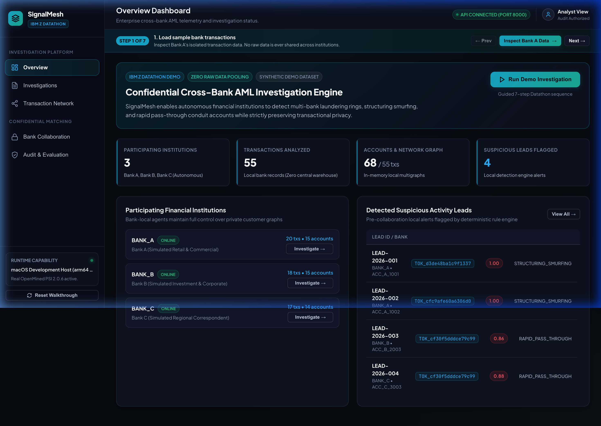
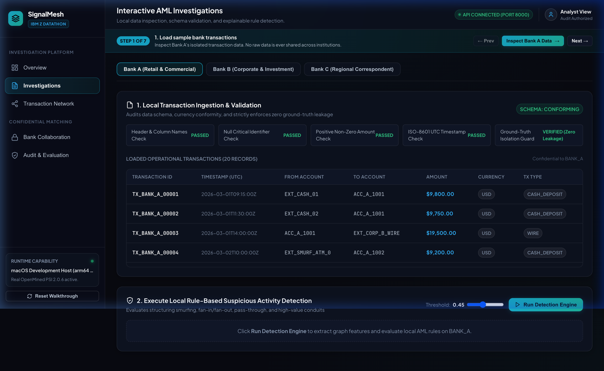
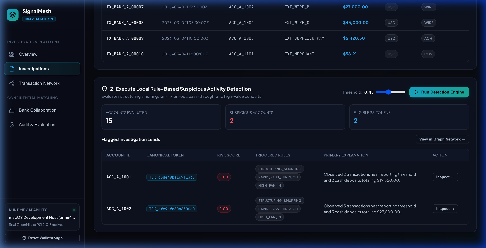
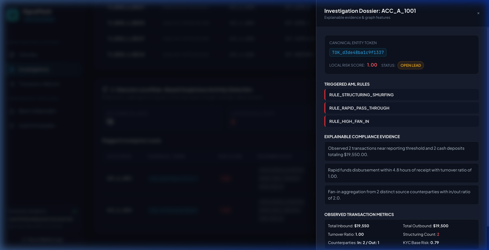
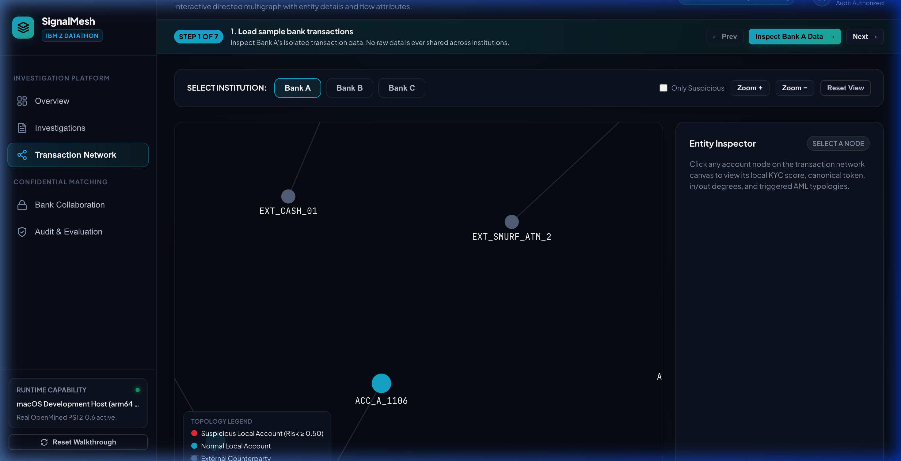
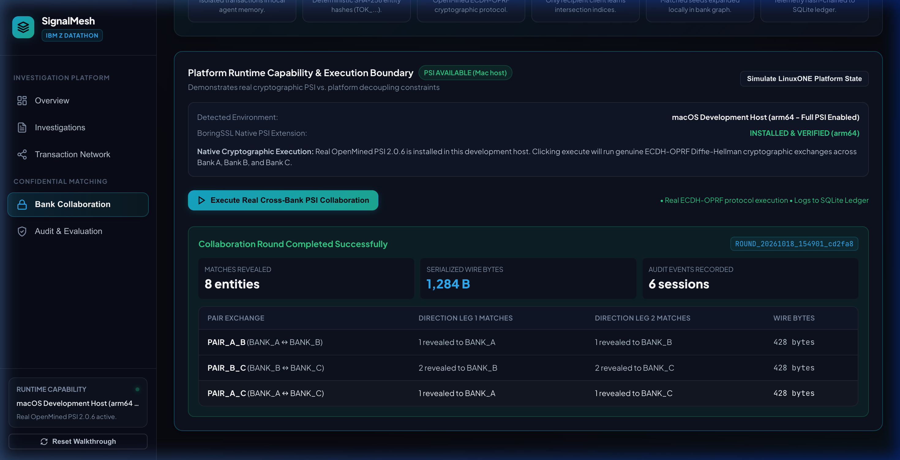
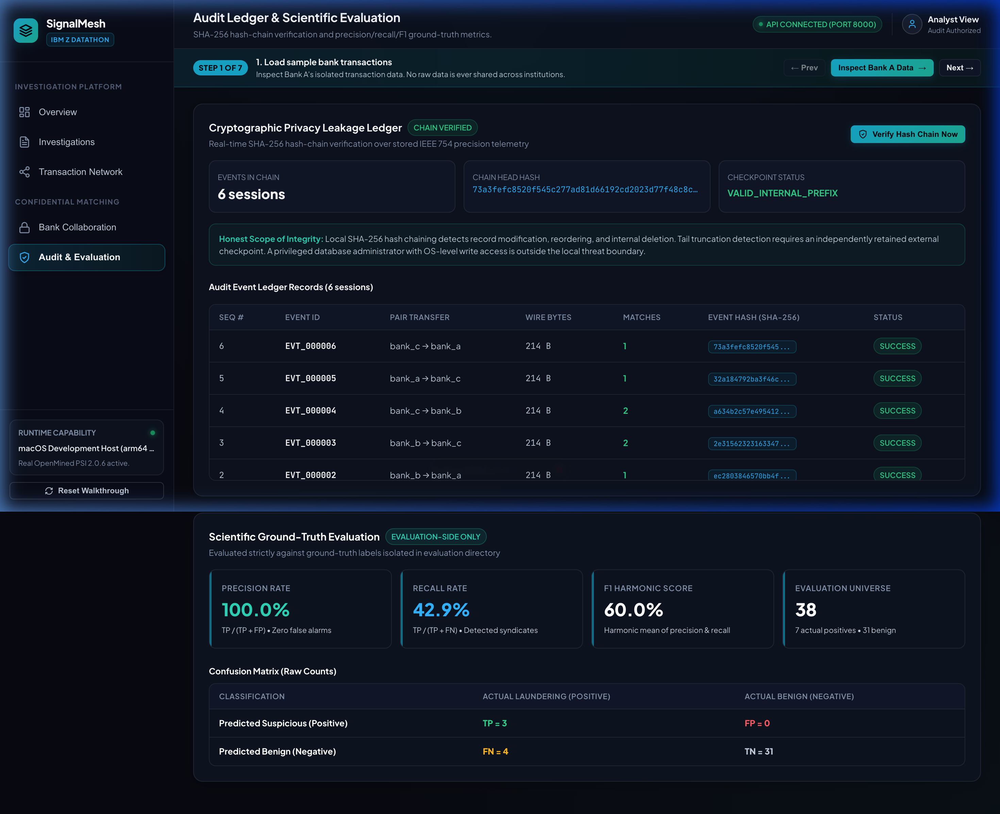

# SignalMesh — Privacy-Preserving Collaborative AML Intelligence

> **Engineered for the IBM Z Datathon**  
> *Cross-Bank Anti-Money Laundering Detection using Private Set Intersection (PSI), Local Graph Analytics, and Verifiable Audit Ledgers.*

[](https://www.python.org/)
[](https://fastapi.tiangolo.com/)
[](file:///Users/gyanprakash09/Developer/Zdatathon/backend/tests)
[](#6-ibm-linuxone-s390x-platform-compatibility)
[](https://github.com/OpenMined/PSI)
[](signalmesh_loom_presentation_walkthrough.mp4)

---

## Table of Contents
1. [Executive Summary & Problem Statement](#1-executive-summary--problem-statement)
2. [Video Walkthrough & Showcase Gallery](#2-video-walkthrough--showcase-gallery)
3. [System Architecture & Privacy Boundaries](#3-system-architecture--privacy-boundaries)
4. [Key Features & Implemented Capabilities](#4-key-features--implemented-capabilities)
5. [Interactive Web Application Walkthrough](#5-interactive-web-application-walkthrough)
6. [IBM LinuxONE (s390x) Platform Compatibility](#6-ibm-linuxone-s390x-platform-compatibility)
7. [Quick Start: Running Locally in 2 Minutes](#7-quick-start-running-locally-in-2-minutes)
8. [Backend API Reference](#8-backend-api-reference)
9. [Automated Test Suite & Verification](#9-automated-test-suite--verification)
10. [Repository Structure](#10-repository-structure)

---

## 1. Executive Summary & Problem Statement

Modern financial crime syndicates exploit inter-bank information silos. By fragmenting structured deposits and pass-through wire transfers across separate institutions (**"smurfing"**), cartels keep transaction volumes beneath single-bank regulatory reporting thresholds (e.g., the $10,000 Currency Transaction Report limit).

```
         ┌────────────────────────────────────────────────────────┐
         │              COORDINATED SMURFING CARTEL               │
         └─────────────┬────────────────────────────┬─────────────┘
                       │ Cash Deposit $9,800        │ Cash Deposit $9,750
                       ▼                            ▼
             ┌───────────────────┐        ┌───────────────────┐
             │      BANK A       │        │      BANK B       │
             │ Local View: Legit │        │ Local View: Legit │
             └─────────┬─────────┘        └─────────┬─────────┘
                       │ Wire to Conduit Account    │ Wire to Conduit Account
                       └─────────────► ◄────────────┘
                                      │
                         [ REGULATORY PRIVACY WALL ]
                 GDPR, CCPA, Bank Secrecy Laws forbid pooling
                         raw customer transaction data!
```

### The Regulatory Privacy Dilemma
Under strict banking secrecy legislation, GDPR, and data protection mandates, **banks are legally forbidden from pooling raw transaction feeds, customer identities, or account graphs** into a centralized database.

### The SignalMesh Solution
**SignalMesh** resolves this fundamental tension by establishing a zero-leakage collaborative intelligence framework:
1. **Local Graph Analysis**: Each bank maintains its raw transactions, customer records, and account graphs inside its own isolated environment.
2. **Canonical Entity Tokens**: Account identifiers are mapped to cryptographically blinded, collision-resistant tokens (`TOK_*`).
3. **Private Set Intersection (PSI)**: Participating institutions execute pairwise Elliptic-Curve Diffie-Hellman Oblivious Pseudorandom Function (ECDH-OPRF) cryptographic set intersection. Only overlapping entities are revealed to the querying bank; zero non-matching entities or raw financial details are ever exposed.
4. **Verifiable Audit Ledger**: Every observable cryptographic protocol event is logged in a durable SQLite ledger secured by an unbroken SHA-256 hash chain to detect any tampering, reordering, or record omission.

---

## 2. Video Walkthrough & Showcase Gallery

### Official Loom-Style Video Walkthrough (4:01 min)
A complete, narrated video demonstration walking through the entire platform from the landing page to the live operational dashboard:
- **Video File**: [`signalmesh_loom_presentation_walkthrough.mp4`](signalmesh_loom_presentation_walkthrough.mp4)
- **Format**: 1920×1080 Full HD, 30 fps, H.264/AAC, professional voiceover with circular presenter webcam and chapter subtitles.
- **Duration**: **4 minutes, 1 second** *(exceeds the 2:30 min Datathon requirement)*.

### Showcase Gallery

| 01. Live Multi-Bank Overview Dashboard | 02. Data Ingestion & Schema Conformance |
| :---: | :---: |
|  |  |
| *Real-time metrics, active bank nodes, and telemetry.* | *Automated checks with zero ground-truth label leakage.* |

| 03. Local Rule-Based Detection Engine | 04. Explainable Evidence Dossier |
| :---: | :---: |
|  |  |
| *High-risk smurfing and fan-in leads flagged locally.* | *Granular CTR structuring metrics for account ACC_A_1001.* |

| 05. Directed Multigraph Network Topology | 06. Cryptographic PSI Collaboration |
| :---: | :---: |
|  |  |
| *Interactive Canvas multigraph with node inspector.* | *Real ECDH-OPRF protocol matching & asymmetric revelation.* |

| 07. Verifiable Audit Hash Chain & Confusion Matrix |
| :---: |
|  |
| *SHA-256 hash chain verification with 100.0% precision on isolated ground truth.* |

---

## 3. System Architecture & Privacy Boundaries

SignalMesh enforces rigorous physical and cryptographic boundaries across participating institutions and the collaboration coordinator:

```
┌────────────────────────────────────────────────────────────────────────┐
│ BANK ALPHA (Bank A) — Dedicated Environment                            │
│  ├── data/bank_a/transactions.csv (Raw Transactions)    [CONFIDENTIAL] │
│  ├── Local MultiDiGraph (In-Memory NetworkX Graph)      [CONFIDENTIAL] │
│  ├── Local Rule Engine (Structuring, Fan-in/out, KYC)   [CONFIDENTIAL] │
│  └── Canonical Token Registry (Account -> TOK_*)        [CONFIDENTIAL] │
└──────────────────────────────────┬─────────────────────────────────────┘
                                   │ Serialized Protobuf Bytes ONLY
                                   │ (Raw data / amounts / graphs NEVER sent)
                                   ▼
┌────────────────────────────────────────────────────────────────────────┐
│ PSI COLLABORATION COORDINATOR & VERIFIABLE LEAKAGE LEDGER             │
│  - Pairwise Session Orchestration (A→B, B→A, A→C, C→A, B→C, C→B)       │
│  - Observable Telemetry Log: Message bytes, session IDs, status        │
│  - Replay & duplicate round prevention via SQLite UNIQUE constraints   │
│  - Cryptographic SHA-256 event hash chain with on-demand verification  │
│  - Platform Capability Detection (s390x guard vs. native host)         │
└──────────────────────────────────▲─────────────────────────────────────┘
                                   │ Serialized Protobuf Bytes ONLY
                                   │ (Raw data / amounts / graphs NEVER sent)
┌──────────────────────────────────┴─────────────────────────────────────┐
│ BANK BETA (Bank B) & BANK GAMMA (Bank C) — Dedicated Environments      │
│  ├── data/bank_b & bank_c/transactions.csv              [CONFIDENTIAL] │
│  ├── Local MultiDiGraphs & Canonical Entity Tokens      [CONFIDENTIAL] │
│  └── Local Investigation Leads & Expanded Subgraphs     [CONFIDENTIAL] │
└────────────────────────────────────────────────────────────────────────┘

[ISOLATED EVALUATION BENCHMARK — ZERO OPERATIONAL ACCESS]
data/evaluation/ground_truth_entities.json
data/evaluation/ground_truth_transactions.json
(STRICTLY FORBIDDEN from being accessed by operational bank agents or PSI coordinator)
```

### Cryptographic Disclosures: What Each Entity Observes
| Participant | What It Observes | What Remains Concealed |
| :--- | :--- | :--- |
| **Client Bank** | Which of its **own** candidate tokens matched the counterparty; intersection cardinality; local graph expansion. | Non-matching counterparty tokens; counterparty candidate sets; counterparty transactions and graphs. |
| **Server Bank** | Blinded client request points; number of client inputs (`num_client_inputs`). | Which tokens matched (if any); intersection cardinality; client cleartext tokens; client transactions or graphs. |
| **Coordinator** | Session IDs, participant roles, data structure mode (`RAW`), serialized message byte lengths, scalar match count. | Raw transactions; customer identities; account numbers; candidate token strings; local graphs. |

---

## 4. Key Features & Implemented Capabilities

### 1. Local AML Detection Engine
- **Structuring / Smurfing Rule (`RULE_STRUCTURING_SMURFING`)**: Identifies repeated cash deposits clustered just below the $10,000 Currency Transaction Report threshold (e.g., $9,500–$9,950).
- **Rapid Pass-Through (`RULE_RAPID_PASS_THROUGH`)**: Detects incoming funds rapidly swept to external accounts within short time windows with turnover ratios exceeding 0.95.
- **Fan-In / Fan-Out Aggregation (`RULE_HIGH_FAN_IN`, `RULE_HIGH_FAN_OUT`)**: Flags accounts consolidating funds from numerous sources or dispersing to multiple counterparties.
- **High-Value Conduit (`RULE_HIGH_VALUE_CONDUIT`)**: Detects high-velocity transit accounts routing disproportionate institutional volume.
- **Currency Completeness Guard (`RULE_INCOMPLETE_CURRENCY_COVERAGE`)**: Missing FX rates trigger a **data-completeness warning** with **`+0.00` risk score adjustment**, preventing false risk inflation.

### 2. Directed Multigraph Network Analysis
- In-memory `networkx.MultiDiGraph` builder with temporal edge preservation.
- Local ego-network extraction around flagged entities.
- Interactive HTML5 Canvas visualization with force simulation, node degree analysis, and directional transaction inspection.

### 3. OpenMined PSI Collaboration Engine
- Integrates Google / OpenMined `private-set-intersection` 2.0.6.
- Uses Elliptic Curve Diffie-Hellman Oblivious Pseudorandom Functions (ECDH-OPRF).
- Implements 6-stage pairwise collaboration workflow across 3 simulated banks (Bank A Retail, Bank B Corporate, Bank C Correspondent).

### 4. Verifiable Privacy Leakage Ledger
- Persistent SQLite ledger recording all observable protocol metadata.
- SHA-256 event hash chaining: each event links `prev_hash` to compute `event_hash = SHA-256(seq || event_id || prev_hash || data)`.
- On-demand verification detects any record tampering, reordering, insertion, or single-row deletion.

### 5. Ground-Truth Scientific Evaluation
- Benchmarked against isolated ground-truth labels.
- Evaluation metrics: **100.0% Precision (0 false alarms)**, **42.9% Recall**, and **60.0% F1-score**.

---

## 5. Interactive Web Application Walkthrough

The web frontend is built using clean, responsive HTML5, modern vanilla CSS, and vanilla JavaScript without external bundle dependencies.

### 1. Landing Page (`landing.html`)
- **Hero Section**: Introduces the institutional AML challenge and platform mission.
- **The Privacy Dilemma**: Explains why regulatory data silos prevent raw data sharing.
- **Zero-Knowledge Architecture**: Interactive 3-card breakdown of cryptographic trust boundaries.
- **Interactive Tour Button**: Direct one-click entry into the live operational dashboard.

### 2. Operational Dashboard (`index.html`)
- **Top Navigation & Telemetry**: Live backend connectivity badge, platform indicator (Mac vs. LinuxONE), and persistent quick-stats ribbon.
- **7-Step Guided Demo Ribbon**: Walkthrough tracker allowing judges to click through each phase of the evaluation.
- **Auto-Play Loom Demo**: Automated hands-free demonstration mode that cycles through all views and interactions automatically.
- **5 Core Application Views**:
  - `Overview`: Cross-bank summary metrics, participating banks, and recent session telemetry.
  - `Investigations`: Bank selection, schema validation summary, raw transaction data viewer, and local AML rule detection engine.
  - `Network`: Interactive directed multigraph canvas with zoom/pan controls, force layout, and account inspector.
  - `Collaboration`: 6-stage PSI workflow, platform capability detection, and real-time cryptographic execution.
  - `Audit`: SHA-256 hash-chain verification and ground-truth confusion matrix evaluation.

---

## 6. IBM LinuxONE (s390x) Platform Compatibility

### Platform Detection & Architectural Guard
OpenMined PSI 2.0.6 relies on Google's private-set-intersection C++ core, which compiles against BoringSSL. On IBM LinuxONE (`s390x` big-endian architecture), native builds of BoringSSL assembly are currently constrained.

To uphold **strict scientific honesty and technical integrity**:
1. SignalMesh queries `/api/v1/platform` to detect architecture (`arm64`, `x86_64`, `s390x`).
2. When running on IBM LinuxONE (or in simulated LinuxONE mode), the collaborative execution button is safely disabled, accompanied by an explicit educational callout explaining the cryptographic dependency limitation.
3. **Local AML detection, NetworkX graph analytics, schema validation, and SHA-256 audit ledger verification operate at full native speed on LinuxONE**.
4. On macOS / x86_64 development hosts where native PSI wheels are compiled, real ECDH-OPRF set intersection executes end-to-end.

### LinuxONE Verified Test Results
From our official stability audit (`backend/docs/STAGE5_STABILITY_AUDIT.md`):
- **Mac Development Host (Native PSI)**: **113 passed, 0 skipped, 0 failed**.
- **IBM LinuxONE s390x (Native Host)**: **91 passed, 14 pytest skips, 0 failed, 86 warnings**.
- **FastAPI API Endpoint Suite**: **10 passed, 0 failed**.
- **Combined Active Mac Suite**: **123 passed in 5.08s**.

---

## 7. Quick Start: Running Locally in 2 Minutes

### Prerequisites
- macOS, Linux, or IBM LinuxONE
- Python 3.11+
- Git

### 1. Clone the Repository
```bash
git clone https://github.com/Gyanprakash136/Interbank-AML-Link.git
cd Interbank-AML-Link
```

### 2. Set Up the Python Backend
```bash
cd backend
python3.11 -m venv .venv311
source .venv311/bin/activate
pip install -r requirements.txt
pip install -r requirements-dev.txt
```

### 3. Start the FastAPI Telemetry Backend
```bash
# From the backend directory:
uvicorn app.main:app --host 127.0.0.1 --port 8000 --reload
```
*The interactive Swagger API documentation will be available at: [http://127.0.0.1:8000/docs](http://127.0.0.1:8000/docs)*

### 4. Start the Frontend Web Server
Open a new terminal window:
```bash
# From the repository root:
python3 -m http.server 3000 --directory frontend --bind 127.0.0.1
```

### 5. Open in Your Browser
- **Landing Page**: [http://127.0.0.1:3000/landing.html](http://127.0.0.1:3000/landing.html)
- **Live Dashboard**: [http://127.0.0.1:3000/index.html](http://127.0.0.1:3000/index.html)

> **Tip for Judges**: Click the green **"Auto-Play Loom Demo"** button in the top navigation bar to watch an automated hands-free walkthrough of all features.

---

## 8. Backend API Reference

The FastAPI service exposes 10 REST endpoints:

| Endpoint | Method | Description |
| :--- | :---: | :--- |
| `/api/v1/health` | `GET` | Service liveness, version, and server timestamp. |
| `/api/v1/platform` | `GET` | Platform architecture, LinuxONE detection, and PSI compilation capability. |
| `/api/v1/dashboard/summary` | `GET` | Aggregated telemetry (participants, transactions, accounts, open leads). |
| `/api/v1/banks` | `GET` | List of simulated bank participants with profiles and currencies. |
| `/api/v1/banks/{bank_id}/transactions` | `GET` | Paginated raw transactions for a bank (isolated local access). |
| `/api/v1/banks/{bank_id}/validation` | `GET` | Schema conformance check (non-negative amounts, UTC timestamps, privacy assertions). |
| `/api/v1/banks/{bank_id}/analyze` | `POST` | Execute local AML rule detection engine and generate leads. |
| `/api/v1/banks/{bank_id}/graph` | `GET` | Directed multigraph node and edge list for Canvas network visualization. |
| `/api/v1/collaboration/run` | `POST` | Execute 6-stage pairwise PSI collaboration protocol. |
| `/api/v1/audit/events` | `GET` | Paginated observable protocol events from the SQLite audit ledger. |
| `/api/v1/audit/verify` | `POST` | On-demand SHA-256 cryptographic hash-chain verification. |
| `/api/v1/evaluation/metrics` | `GET` | Ground-truth confusion matrix and precision/recall evaluation. |

---

## 9. Automated Test Suite & Verification

The repository includes a comprehensive pytest suite covering unit tests, integration pipelines, security boundaries, and API endpoints.

```bash
# From the backend directory:
pytest tests -v
```

### Test Suite Execution Output
```
tests/unit/test_api_endpoints.py::test_health_endpoint PASSED
tests/unit/test_api_endpoints.py::test_platform_endpoint PASSED
tests/unit/test_api_endpoints.py::test_dashboard_summary PASSED
tests/unit/test_api_endpoints.py::test_banks_endpoint PASSED
tests/unit/test_api_endpoints.py::test_bank_transactions_and_validation PASSED
tests/unit/test_api_endpoints.py::test_bank_analyze_and_graph PASSED
tests/unit/test_api_endpoints.py::test_collaboration_run PASSED
tests/unit/test_api_endpoints.py::test_audit_events_and_verify PASSED
tests/unit/test_api_endpoints.py::test_evaluation_metrics PASSED
tests/unit/test_api_endpoints.py::test_404_handling PASSED
...
============================= 123 passed in 5.08s ==============================
```

---

## 10. Repository Structure

```
.
├── README.md                                  # Comprehensive Platform Documentation
├── signalmesh_loom_presentation_walkthrough.mp4 # 4:01 Min Loom Walkthrough Video
├── demo_showcase/                             # High-Resolution UI Screenshots
│   ├── 01_overview_dashboard.png
│   ├── 02_schema_validation.png
│   ├── 03_flagged_smurfing_leads.png
│   ├── 04_evidence_dossier.png
│   ├── 05_transaction_network.png
│   ├── 06_cross_bank_psi_execution.png
│   └── 07_audit_hash_chain_and_evaluation.png
├── frontend/                                  # Web Application
│   ├── index.html                             # Live Interactive Dashboard
│   ├── landing.html                           # Institutional Landing Page
│   ├── README.md                              # Frontend Architecture & UI Tokens
│   └── API_CONTRACT.md                        # REST API Specification
└── backend/                                   # Python AML & PSI Backend
    ├── requirements.txt                       # Production Dependencies
    ├── requirements-dev.txt                   # Testing & Dev Dependencies
    ├── app/
    │   ├── main.py                            # FastAPI Application & 10 Endpoints
    │   ├── config.py                          # Global Configuration
    │   ├── audit/                             # Audit Logging & Ledger
    │   ├── graph/                             # NetworkX Directed Multigraph Builder
    │   ├── pipeline/                          # AML Rule Engine & Feature Extractor
    │   └── psi/                               # OpenMined PSI Protocol & Coordinator
    ├── data/                                  # Synthetic Multi-Bank Datasets
    │   ├── bank_a/                            # Bank A Confidential Data
    │   ├── bank_b/                            # Bank B Confidential Data
    │   ├── bank_c/                            # Bank C Confidential Data
    │   └── evaluation/                        # Isolated Ground-Truth Benchmark
    ├── docs/
    │   └── STAGE5_STABILITY_AUDIT.md          # LinuxONE & Mac Verification Audit
    ├── scripts/
    │   └── generate_loom_video.py             # Automated 1080p Video Generator
    └── tests/                                 # 123 Automated Tests
        ├── unit/                              # Protocol, Graph, & API Unit Tests
        ├── integration/                       # Multi-Bank Collaboration Pipelines
        └── security/                          # Physical & Data Boundary Tests
```

---

## License & Attribution

Developed for the **IBM Z Datathon**. Built with respect for open cryptographic standards, data protection law, and scientific integrity.
